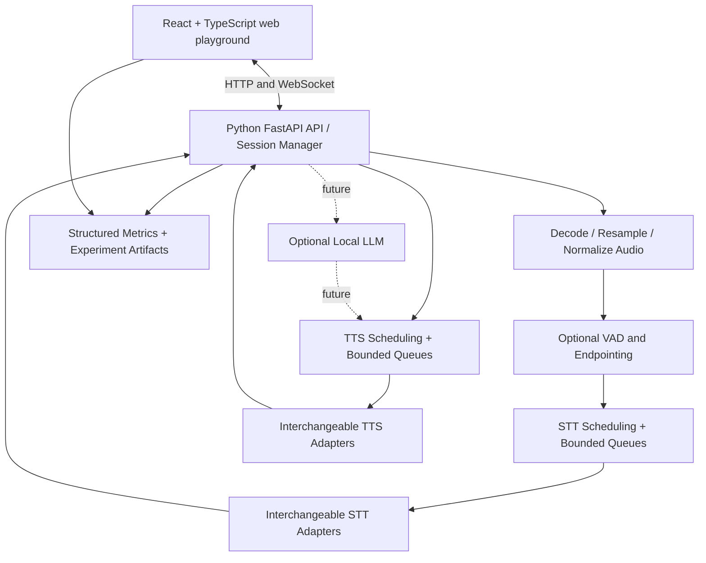

# TTS–STT Playground — Project Brief, Architecture, Research, and Conversation Notes

**Version:** 1.0  
**Prepared:** 2026-10-17  
**Audience:** Local AI coding agent implementing the project  
**Status:** Engineering brief / experimentation plan; **not** a claim that the project has already been implemented

> This document consolidates the user's goals and the technical discussion into a handoff for a local coding agent. It captures the substance of the entire conversation (questions, explanations, candidate models, design options and cautions), rather than reproducing every prior assistant message verbatim. Distinguish verified upstream documentation from recommendations and untested hypotheses. Where a feature is not supported, show that clearly instead of simulating it silently.

---

## 0. First instruction to the coding agent

Build a runnable, local-first **`tts-stt-playground`** with a **React/TypeScript browser client** and a **server-side Python backend**. Its purpose is to **experiment with and benchmark self-hosted, free/open-weight speech-to-text (STT, also called ASR) and text-to-speech (TTS)** models using multiple processing strategies:

- File upload / offline inference.
- Live audio transport and true native streaming inference, where the model supports it.
- Pseudo-streaming using buffered / rolling / overlapping chunks for non-streaming models.
- Single-request inference, fixed batching of multiple independent requests, and—in supported engines—dynamic/continuous batching.
- CPU versus GPU execution.
- Multiple simultaneous clients; queues, backpressure, isolation of per-user streaming state.
- Client-side VAD, server-side VAD, and hybrid VAD.
- Objective latency, throughput, memory, and transcription-quality comparison.

**Do not hardcode the application to one model, one transport mode, or one GPU backend.** Implement adapters and a capabilities registry; expose what each adapter actually supports. Prioritize a working MVP before adding more models and advanced scheduling.

The long-term product is a voice-enabled personal AI assistant for web and React Native Android/iOS. This repo is **only the experimental speech playground** initially. An LLM is not required for the MVP; an end-to-end STT → LLM → TTS demo is a later optional milestone.

**Non-negotiables:** No paid model APIs; speech inference must happen on the backend; browser client controls and results must be observable; do not mislabel rolling-window transcription as true model streaming or simple one-at-a-time scheduling as GPU batching.

---

## 1. Original goals and assumptions

### User's goals

- Eventually create a **personal AI assistant** with a browser web app and React Native apps for Android and iOS.
- Start by implementing **speech-to-text** and **text-to-speech** on the backend.
- Allow multiple concurrently connected clients with shared models; avoid creating a model instance per client.
- Explore whether the client should record the full utterance or stream audio continuously.
- Understand and compare **streaming, chunking, batching, CPU, GPU, VAD**, latency and model performance.
- All chosen inference models must be freely self-hostable, with suitable weight and dependency licenses.
- Produce a playground where models and execution modes can be changed without changing the frontend.

### Potential development hardware

From a related discussion, a potential local machine is **Windows 11, AMD Radeon RX 9070 XT with 16 GB VRAM and approximately 30 GB system RAM**. Treat this as a **likely test target, not a guaranteed deployment requirement**. CPU-only operation must also work. The user has discussed home mini PCs / Proxmox as possible future infrastructure.

Important compatibility note: **AMD GPU support is model-runtime-specific**. AMD's documentation lists RX 9070 XT in supported Windows PyTorch/ROCm configurations, but the **full ROCm stack is not necessarily supported on Windows**. Validate the exact environment and packages. A CUDA-first example does not imply support on an AMD GPU. `whisper.cpp` documents Vulkan and AMD HIP/ROCm options. Do not claim all candidate Qwen runtimes support this Radeon on Windows until tested.

### Terminology

- **STT / ASR:** audio → transcription. The original conversation used “STS” in one place; this document assumes STT.
- **TTS:** text → generated audio.
- **Speech-to-speech (S2S):** direct voice input → voice output; a different potential future approach, not required now.
- **Inference:** *using* an already-trained model, not training it. STT, TTS, and LLM generation are all inference.
- **Session:** one active audio conversation/stream; a user may have many sessions over time.

---

## 2. Recommended system architecture



### Logical services versus physical machines

**Three logical services** are useful:

1. **API / WebSocket service** — authentication for remote use, session ownership, routing, incoming frames, metadata and observability.
2. **STT worker** — owns the ASR model(s), streaming state, VAD/endpointing or normalized speech segments, inference scheduling.
3. **TTS worker** — owns the TTS model(s), text generation jobs, audio chunk delivery.

They **do not need three computers or even three Docker containers in the MVP**. One host can run them as separate modules/processes or in one development app. Keep the architecture modular so worker processes/containers can split later. Multiple replicas may consume additional model RAM/VRAM, since each may load a copy of the weights. With a 16 GB GPU, preloading several large models simultaneously may not fit; provide model load/unload or one-at-a-time experiment selection.

### Networking versus inference

- Prefer Python **FastAPI** initially for HTTP/WebSocket endpoints. It is a Python framework for APIs, broadly analogous to Express.js in Node.js.
- WebSocket handler receives frames and puts them into a **bounded, per-session buffer/queue**, not a long blocking inference call.
- A worker asynchronously consumes work. Other clients and later frames from the **same** client can be accepted while a previous inference is running.
- Asynchronous HTTP/WebSocket I/O **does not imply** that the GPU can compute all requests simultaneously. Scheduling/concurrency is separate.
- Keep model weights shared within each model worker; maintain **recognition state per stream**.
- For multiple sessions: each gets its own session ID, audio buffer, VAD state, decoder/model state, metrics, cancellation handling, and ordered events.

### Future transport

- **MVP:** HTTP audio files and WebSocket streaming.
- **Later:** optionally self-host LiveKit/WebRTC for full-duplex, interruption, jitter control and mobile-friendly real-time media; do not make WebRTC a prerequisite.

---

## 3. Processing modes to implement and compare

| ID | Mode | Incoming data | Inference behavior | Typical use |
|---|---|---|---|---|
| `file_single` | Whole file, single | Entire completed recording | One offline inference | Baseline, push-to-talk / voice notes |
| `file_batch` | Whole files, fixed batch | Several independent completed recordings | One multi-item batch where supported | Throughput benchmark |
| `live_native` | True streaming | Small successive PCM frames | Session retains context/state and emits partial/final text | Interactive voice |
| `live_windowed` | Pseudo-streaming | Small successive PCM frames | Accumulate + infer on window with optional overlap | Use offline ASR in live UI |
| `live_endpointed` | VAD utterance buffering | Audio arrives live | Wait for end-of-utterance, then call offline ASR | Simpler live baseline |
| `live_batched` | Multi-stream batching | Frames from multiple clients | Shared model processes streams together while preserving separate states | Advanced throughput/latency tests |
| `tts_file` | Nonstreaming TTS | Complete text | Generate playable/downloadable WAV | Baseline |
| `tts_stream` | Incremental TTS | Text or text fragments | Return actual audio chunks before complete output | Low-latency playback |
| `tts_batch` | Batched TTS | Several independent texts | Batch synthesis where officially supported | Throughput benchmark |

**A capability needs explicit implementation**: unsupported combinations should be disabled in UI and rejected by API with a clear reason. For example, a given Qwen3-ASR official streaming backend may not support batching. Do not fake “streaming” by emitting a final WAV in arbitrary network segments without labeling it `output_chunked` rather than `model_streaming`.

### Three different concepts that must stay distinct

1. **Audio transport frames:** e.g. send 20–100 ms PCM frames over WebSocket. A frame can end mid-word. Its boundary is not a linguistic boundary.
2. **Inference chunks/windows:** the ASR engine may aggregate incoming frames into chunks of an allowed size (or a rolling, overlapping audio window). It may also use right-context lookahead. Do not assume all models accept arbitrary 100 ms inference chunks.
3. **Inference batching:** combine **different independent jobs or active streams** so one model call/kernel uses hardware more efficiently. Batching does *not* mean arbitrarily splitting a single 30-second file into three 10-second files.

Chunking a single long audio file can still be an independent experiment, but label it as `file_chunked`, handle overlap/context and timestamp merging, and benchmark its transcription errors around word boundaries.

---

## 4. How true streaming STT works (conversation finding)

### Question: Does the model still have chunks 1 and 2 when chunk 3 arrives?

**It often retains information about earlier chunks, but not necessarily the original raw bytes.** Streaming ASR is *stateful*.

Possible per-session state:

- RNN/recurrent hidden state.
- Transformer attention or KV cache.
- Convolution cache / retained acoustic features.
- Decoder hypothesis (tokens recognized so far).
- Limited left/right acoustic context and timestamps.

Example:

```text
User A:   audio frame 1 -> audio frame 2 -> audio frame 3 -> ...
Engine:   (frame 1, state0) -> (partial text, state1)
          (frame 2, state1) -> (partial text, state2)
          (frame 3, state2) -> (partial/final text, state3)
```

The model weights are shared across users, while session states are separate. The recognizer may revise preliminary words after seeing later audio. `transcript.partial` is **unstable**, while `transcript.final` is committed. A model may require delayed future context to identify a sound or word correctly.

Other systems advertised as “streaming” may **accumulate received audio and repeatedly re-run an offline model** over a growing or rolling window (sometimes with text context). That is not equivalent in performance to a cache-efficient streaming encoder. Inspect the exact upstream implementation rather than equating an API labeled streaming with a specific cache design.

**Never transcribe each WebSocket packet independently.** Frames can split words. Keep session context or buffer with overlap; use VAD/endpointing to decide when the utterance is finalized.

### When does the utterance end?

VAD (Voice Activity Detection) finds speech versus nonspeech, while **endpointing** decides when a speaker has finished a conversational turn. Possible heuristic: after speech, finalize if silence exceeds a tunable threshold (e.g. 500–1000 ms). These values are only experimental defaults; short thinking pauses should not necessarily end the turn. Some engines provide their own endpoint detector.

Retain a **pre-speech ring buffer** (e.g. 200–300 ms) and **post-speech tail / hangover** so quiet phonemes are not lost. VAD errors must be measured, especially faint starts, background music/noise and brief pauses.

### Streaming with batching?

**Yes, in principle.** A compatible scheduler can group the *next computation step* from multiple active streams into one batch, with separate cache/decoder state per stream. A new frame may arrive while others are being processed. This is **multi-stream batching**, distinct from `file_batch`.

However, this is **model-/engine-specific**. A common library may support batch *offline* inference but not streaming batch. As of this document, official Qwen3-ASR docs say its vLLM streaming mode **does not support batch inference or timestamps**. The playground must expose this as unsupported until newer upstream functionality is validated.

---

## 5. Fixed batching versus dynamic batching: 5s, 10s and 30s recordings

### The user's concrete question

> If a batch contains recordings lasting 5, 10 and 30 seconds, does it return all three texts only after the 30-second file completes?

### Answer

**A simple, synchronous fixed-batch API commonly returns all results when the entire batch call completes.** Therefore the short recordings can experience *head-of-line waiting* for the longest one. Some batching implementations pad inputs toward a common length, potentially wasting computation. This is **not a universal property of every batch implementation**, and 30 seconds of recorded audio **does not mean 30 seconds of GPU wall-clock computation**.

A better serving engine may schedule chunks/iterations, remove completed requests from the active group, and **deliver each result as it finishes**. This is often called dynamic batching, in-flight batching or continuous/iterative batching, depending on architecture. These terms are not universally interchangeable: document the scheduler's actual behavior.

Record separately:

- **Batch throughput** (audio-seconds processed per wall-clock second / requests per second).
- **Each individual request's latency** from submission to first partial and final result.
- **Batch completion time**.
- **Padding/wasted work**, if observable.
- **Scheduling overhead and fairness** for unequal input lengths.

Experiments to run:

1. Sequential inference: 5s → 10s → 30s.
2. Three independent jobs in parallel with a concurrency limit.
3. Fixed batch of all three, collect results at once.
4. Dynamic batching if truly supported, emit outputs separately.
5. Repeat with a reversed arrival order and 1/3/5/10 concurrent clients.

Avoid declaring batch superior just because total throughput increases: a real-time assistant prioritizes **tail latency** and responsiveness, not only throughput.

---

## 6. Queues and concurrency limits

### Why bound active inference?

A single GPU can handle only a limited workload and amount of VRAM. Launching too many model calls or loading too many workers may cause severe latency or out-of-memory failures.

Example: capacity = 3 active inference requests; 10 arrive → accept 3 for processing and place 7 in a **bounded queue**. As tasks finish, admit new tasks.

Implementation guidance:

- Configure per-adapter `max_active_requests`, `max_queued_requests`, optional `max_batch_size`, timeouts and priority policy.
- Keep **per-session input buffers bounded**. Live audio arriving faster than processing creates growing delay.
- Provide backpressure/flow-control, explicit overload responses, cancellation and queue-time metrics. For live sessions, consider rejecting new streams over indefinite queuing.
- A semaphore limits active calls, but **does not create GPU microbatching**. Actual batching requires model/engine-specific execution that accepts multiple inputs together.
- Keep streaming state isolated; clear allocated state on disconnect/cancel/timeout.
- Different model families may need separate process environments/dependency versions, not merely different Python objects.

### What “async WebSocket” really means

Yes: user A's connection can send message 2 while its message 1 is being processed; user B/C can also continue sending. The API places incoming frames in queues and returns quickly to receiving. Workers process those queues. Preserving frame order within each session is important. A single `async def` function making a synchronous blocking GPU call in the event loop does **not** automatically provide this behavior; isolate blocking work in worker process(es) or suitable executors.

---

## 7. Voice Activity Detection: client vs server

The user asked whether performing VAD on the client would save bandwidth. **Yes, it can.** The tradeoff is that a false negative on the client may permanently discard speech that the backend can never recover.

| Policy | Advantage | Downside |
|---|---|---|
| `off` | Send all mic frames; easiest to debug | More network and backend work |
| `server` | Consistent segmentation; original audio available | More bandwidth |
| `client` | Reduce network traffic and backend silence processing | Client CPU use; possible irreversible missed speech; cross-browser variability |
| `hybrid` | Client prefilter + server endpointing on received audio | More complex; server cannot rescue audio client dropped |

**Recommendation:** default to `server` for initial functional tests, then add `client` and `hybrid` to the playground for comparison. UI must show VAD state and detected speech boundaries. Client VAD should send a pre-roll buffer and retain a tail. The backend must handle gaps/timestamps and cannot assume omitted audio was silence unless explicitly signaled by protocol.

Consider `Silero VAD` as a candidate (not the only choice): https://github.com/snakers4/silero-vad

---

## 8. Candidate free/self-hosted models and execution backends

**Licenses below summarize upstream repositories/model cards checked on 2026-10-17; verify model weights, voices, tokenizers, dependent libraries and any third-party resources before shipping.** Free inference does not mean free electricity or cloud GPU rental. Do not silently download proprietary or paid API-backed models.

### STT candidates

| Adapter candidate | Why test | Relevant limitations/notes | Primary source |
|---|---|---|---|
| **sherpa-onnx streaming ASR** | Native streaming, ONNX-oriented CPU option, multi-client server example | Select a *specific* language-compatible streaming model; engine capabilities depend on model | https://github.com/k2-fsa/sherpa-onnx |
| **Moonshine streaming ASR** | Low-latency speech recognition, interesting CPU/streaming baseline | Different checkpoints/languages/licenses; current streaming models MIT; legacy nonstreaming non-English checkpoints may be noncommercial | https://github.com/moonshine-ai/moonshine |
| **whisper.cpp** | Portable C/C++; CPU + Vulkan + ROCm/HIP backends, particularly relevant to AMD | Whisper is primarily offline/segment-based; live examples may use rolling windows, not a cache-native model | https://github.com/ggml-org/whisper.cpp |
| **faster-whisper** | Mature offline and batched baseline; CTranslate2 | Official GPU guidance primarily CUDA/NVIDIA; do not assume AMD GPU compatibility; CPU works | https://github.com/SYSTRAN/faster-whisper |
| **Qwen3-ASR 0.6B** | Multilingual, offline batch, official streaming via vLLM | Official streaming mode doesn't batch; vLLM/FlashAttention AMD Windows support requires verification | https://github.com/QwenLM/Qwen3-ASR |

**Likely useful STT first runs:** one CPU-capable offline implementation (e.g. `whisper.cpp` or `faster-whisper`) plus one genuine streaming implementation (`sherpa-onnx` with a verified model or Moonshine). Add Qwen3-ASR after cross-platform compatibility investigation.

### TTS candidates

| Adapter candidate | Why test | Notes | Primary source |
|---|---|---|---|
| **Kokoro 82M** | Small, good baseline, relatively resource-efficient | Apache-2.0 model weights; language/voice availability and dependency license must be checked | https://huggingface.co/hexgrad/Kokoro-82M |
| **Qwen3-TTS 0.6B** | Multilingual and official streaming generation | Official model family has streaming; confirm the *chosen server/backend* offers real incremental audio streaming; official examples commonly use CUDA | https://github.com/QwenLM/Qwen3-TTS |
| **Chatterbox-Nano / Turbo** | Low-resource English options | Different variants, voice capabilities and runtime constraints | https://github.com/resemble-ai/chatterbox |
| **Chatterbox Multilingual V3** | Multilingual voice, supports German/Russian/Hebrew, voice cloning | Larger memory/compute footprint than tiny baselines; obtain voice references only with proper consent | https://github.com/resemble-ai/chatterbox |

Potential languages for evaluation: English, German, Russian; optionally Hebrew for models that explicitly support it. Do not advertise support across all languages for every model.

### Confirmed upstream constraints that matter

- **Qwen3-ASR:** repository says streaming is currently available via vLLM and doesn't support batch inference/timestamps in that mode: https://github.com/QwenLM/Qwen3-ASR
- **Qwen3-TTS:** repository identifies 0.6B and 1.7B models, ten languages, streaming generation, and batch usage examples for selected APIs: https://github.com/QwenLM/Qwen3-TTS
- **sherpa-onnx:** documents a Python streaming WebSocket server for multiple clients: https://github.com/k2-fsa/sherpa/blob/master/docs/source/onnx/python/streaming-websocket-server.rst
- **Moonshine:** check its current LICENSE for streaming model licensing vs legacy model exceptions: https://github.com/moonshine-ai/moonshine/blob/main/LICENSE
- **whisper.cpp:** documents Vulkan and ROCm/HIP (`gfx1201` is the RX 9070 XT GPU architecture in its examples): https://github.com/ggml-org/whisper.cpp
- **AMD Windows support:** consult actual versioned support matrix before choosing PyTorch/ROCm builds: https://rocm.docs.amd.com/projects/radeon-ryzen/en/latest/docs/compatibility/compatibilityrad/windows/windows_compatibility.html

### Model capability registry (required)

For each installed adapter expose machine-readable properties, e.g.:

```json
{
  "id": "example-asr-adapter",
  "task": "stt",
  "engine": "example-engine",
  "model_id": "upstream-checkpoint-id",
  "devices_supported": ["cpu"],
  "devices_available_now": ["cpu"],
  "languages": ["en"],
  "modes": {
    "file_single": true,
    "file_batch": false,
    "live_native": true,
    "live_windowed": false,
    "live_batched": false
  },
  "streaming_state_type": "engine-managed",
  "streaming_inference": true,
  "native_batching": false,
  "loaded": false,
  "status": "available",
  "reason_unavailable": null,
  "license_note": "verify exact weights/dependencies"
}
```

Do not present an adapter that wraps full-file inference in rolling windows as `live_native: true`. Distinguish model-native streaming from **chunked network delivery of a fully generated result** in TTS too.

---

## 9. Proposed playground UI

**Primary page:** speech experiment workbench. Keep the UI useful for a single user and multi-client simulation.

### STT panel

- Model selector and details (version, size, languages, license, capabilities).
- Device selector: `auto`, `cpu`, `gpu` (show actual runtime/backend; reject unsupported).
- Mode: `file_single`, `file_batch`, `file_chunked`, `live_native`, `live_endpointed`, `live_windowed`, `live_batched` where possible.
- Audio source: browser microphone, file upload, saved fixtures.
- Mic Start / Stop, push-to-talk, cancel; waveform / input meter.
- Configurable transport frame duration, window size and overlap, VAD policy, silence threshold, max concurrency, batch size. Show controls only when relevant.
- Separate **partial transcript** and **final transcript**; show live revisions without duplicating committed words.
- A time-coded event timeline: frames received, VAD speech start/end, request queued/started/completed, partial/final emitted.

### TTS panel

- Text input, model, voice, language, device, playback speed if supported, generation mode (`tts_file`, `tts_stream`, `tts_batch`).
- Play/stop generated speech and download WAV; stream audio as chunks if supported.
- First-audio-chunk latency, synthesis latency, audio duration, real-time factor, memory usage.
- Optional side-by-side A/B model output listening and comparison.

### Batch & concurrency lab

- Upload multiple files or use fixture dataset; create 1/3/5/10+ simulated clients.
- Show queue, active worker count, batch grouping, arrivals, individual completion times and overall throughput.
- Include unequal-duration scenario **5s, 10s, 30s** to demonstrate fixed-batch head-of-line behavior.
- Distinguish simulated traffic generation from real simultaneous browsers. Support both over time.

### Results

- Save experiment configuration, timestamps, machine/runtime metadata, each request's measurements, failures, logs and model versions.
- Table sorting/filtering, compare runs, download JSON and CSV.
- Charts optional, but keep raw data available. Prefer a reproducible experiment over a fancy UI.
- Include reproducible test fixtures and known reference transcriptions.

---

## 10. API and WebSocket contract (proposed, not upstream APIs)

### HTTP endpoints

| Endpoint | Meaning |
|---|---|
| `GET /api/health` | API and worker status |
| `GET /api/models` | Installed models, verified capabilities, load status |
| `POST /api/models/{id}/load` | Optional: load specific model, after capacity checks |
| `POST /api/models/{id}/unload` | Optional: unload model safely |
| `POST /api/stt/transcribe` | File + model + device + options → result |
| `POST /api/stt/batch` | Multiple audio files, explicit batch options → per-item results and timestamps |
| `POST /api/tts/synthesize` | Text + voice + options → audio + metadata |
| `POST /api/tts/batch` | Batch synthesis if supported |
| `POST /api/benchmarks/runs` | Run a reproducible experiment and capture metrics |
| `GET /api/benchmarks/runs` | Read benchmark history |

### WebSockets

- `WS /api/stt/stream` for sending microphone audio and receiving partial/final text.
- `WS /api/tts/stream` for sending TTS requests and receiving generated audio fragments (later phase).

**Suggested STT WebSocket session:**

```text
Client -> JSON: {"type":"start","session_id":"...","model_id":"...",
                 "sample_rate":16000,"channels":1,"sample_format":"pcm_s16le",
                 "mode":"live_native","vad":"server"}
Server -> JSON: {"type":"ready","session_id":"...","actual_device":"cpu"}
Client -> BINARY: little-endian PCM samples (typically 20–100 ms transport frames)
Server -> JSON: {"type":"speech_started","at_ms":100}
Server -> JSON: {"type":"transcript.partial","text":"I want to...","revision":3}
Server -> JSON: {"type":"transcript.final","text":"I want to book a table.","start_ms":100,"end_ms":2100}
Client -> JSON: {"type":"end_input"}
Server -> JSON: {"type":"session.completed","metrics":{...}}
```

These are **example message shapes**, not a finalized standard. Document and version a precise wire protocol; include sequence numbers and audio timestamps for production robustness. The incoming audio frame can bisect a word; the server's model adapter must retain the correct state/window. Use explicit `end_input` to flush buffered samples, and `cancel` to stop work. Provide structured error codes like `MODE_UNSUPPORTED`, `DEVICE_UNAVAILABLE`, `MODEL_NOT_LOADED`, `QUEUE_FULL`, and `INVALID_AUDIO`.

For streaming TTS, design an unambiguous binary-audio framing format with metadata events for sample rate, encoding and chunk sequence, and a final completion event. A browser player may need a buffered PCM playback implementation; don't expect `HTMLAudioElement` to decode arbitrary raw PCM messages directly.

### Audio formats and normalization

- Default internal ASR audio: **16 kHz mono 16-bit little-endian PCM** if supported; resample for model-specific requirements.
- Browser Web Audio / AudioWorklet captures `Float32` audio at the **actual AudioContext/device rate**; convert/resample rather than merely relabeling it as 16 kHz.
- File uploads may be WAV, WebM/Opus, MP4/AAC etc. depending on browser/runtime; inspect MIME type and use a reliable server decoder (e.g. FFmpeg) into the model's required representation.
- Client `MediaRecorder` is suitable for **full-recording uploads**; `AudioWorklet` is better suited to low-latency PCM streaming. Validate actual browser support rather than assuming a single codec.
- Browser mic access normally requires a secure context (HTTPS or appropriate localhost development exception).
- Timestamp, sample rate and buffering correctness matter for WER and endpoint accuracy.

---

## 11. Benchmarks and experiment methodology

### Required metrics

**STT:**

- `audio_duration_ms`, `transcribe_compute_ms`, `end_to_end_latency_ms`.
- `time_to_first_partial_ms` for live mode and `time_to_final_ms`.
- WER (word error rate) and optionally CER against reference transcripts.
- Real-time factor (RTF): `processing_wall_time / input_audio_duration` (lower than 1 means faster than real-time for an offline job).
- Input and output queue delay; CPU utilization; process RSS; peak GPU VRAM; inference backend/device.
- Revision count of partial transcripts, missed first/last words, and endpoint delay.
- Requests per second, audio seconds processed per second, success/error rate, p50/p95 latency across concurrency levels.

**TTS:**

- `time_to_first_audio_ms` from request submission; `total_synthesis_ms`.
- Generated audio length and `synthesis_rtf` (wall-clock synthesis time / generated audio duration).
- Perceived pronunciation / naturalness via optional manual blind A/B scores.
- Language/voice correctness, glitches at streamed chunk boundaries, memory and GPU/CPU utilization.

**Transport:**

- Bytes sent per session, transport frame duration, websocket message count, dropped/backpressured messages, end-to-end playback delay.

### Suggested benchmark matrix

| Dimension | Values |
|---|---|
| STT source | 5s / 10s / 30s reference files; live microphone; synthetic playback of fixtures |
| STT modes | Offline; file chunking; endpointed; rolling-window pseudo-streaming; native streaming; offline batch; streaming batch if supported |
| TTS modes | Full-file; native streamed; fixed batch if supported |
| Clients | 1, 3, 5, 10 (more only after stability) |
| Device | CPU; AMD GPU where verified/available |
| VAD | Off, server, client, hybrid |
| Conditions | Quiet, background noise, quiet voice, pauses, clipped words |
| Languages | English; German; Russian where supported; optional Hebrew |
| Repeat count | At least 3 per configuration for initial comparison; more for stable p95 |

Record whether each configuration is **supported, unsupported, failed, skipped or successful**, with reasons. Use a fixture's fixed transcript to calculate WER; do not compare WER on audio without a reference. Repeat tests with warm models and identify cold-start separately. Avoid benchmarking multiple heavyweight models at once if their shared VRAM pressures make comparisons unfair.

### Example experiment manifest

```json
{
  "experiment_id": "demo-001",
  "task": "stt",
  "model_id": "adapter-model-version",
  "engine": "runtime-version",
  "mode": "file_batch",
  "device_requested": "gpu",
  "device_used": "cpu",
  "batch_size": 3,
  "concurrency": 3,
  "audio_files": ["en_5s.wav", "en_10s.wav", "en_30s.wav"],
  "warm_model": true,
  "metrics": {
    "batch_wall_ms": null,
    "per_item_latency_ms": [],
    "rtf": null,
    "peak_ram_mb": null,
    "peak_vram_mb": null
  },
  "status": "pending"
}
```

If GPU is requested but CPU is actually used, **surface both** and explain the fallback. For reproducible comparisons, default to **failing visibly** instead of silently falling back; allow explicit `auto` selection separately.

---

## 12. Suggested repository organization

```text
tts-stt-playground/
├── README.md
├── pyproject.toml                   # or backend-specific dependency manifests
├── .env.example
├── apps/
│   └── web/                         # Vite + React + TypeScript
│       └── src/
│           ├── components/
│           ├── pages/
│           ├── audio/               # mic worklet, resampler, PCM playback
│           ├── api/
│           └── state/
├── services/
│   ├── api/                         # FastAPI HTTP/WS, sessions, orchestration
│   ├── stt/
│   │   ├── base.py                  # adapter interface, streaming session API
│   │   ├── registry.py
│   │   ├── adapters/                # each implementation separately
│   │   ├── vad/
│   │   └── scheduler/
│   └── tts/
│       ├── base.py
│       ├── registry.py
│       ├── adapters/
│       └── scheduler/
├── shared/                           # typed schemas / protocol contracts
├── benchmarks/
│   ├── fixtures/                    # short sample audio + reference text
│   ├── runners/
│   └── results/                    # gitignored or small fixtures only
├── docs/
│   ├── MODEL_COMPATIBILITY.md
│   ├── BENCHMARKS.md
│   └── PROTOCOL.md
├── tests/
└── infra/
    └── docker-compose.yml          # optional for dev, CPU-first
```

The folder tree is a **suggestion**, not an implementation constraint. Prefer a small clean repository over a complex distributed architecture before it's needed.

### Adapter interface sketch

```python
class SttAdapter:
    def capabilities(self) -> dict: ...
    async def transcribe_file(self, audio, options): ...
    async def transcribe_batch(self, audios, options): ...  # only where supported
    async def open_stream(self, options): ...              # only native streaming

class SttStream:
    async def push_audio(self, pcm, timestamp_ms): ...
    async def poll_events(self): ...                       # partial/final events
    async def finish(self): ...
    async def cancel(self): ...

class TtsAdapter:
    def capabilities(self) -> dict: ...
    async def synthesize(self, text, options): ...
    async def synthesize_batch(self, texts, options): ...  # where supported
    async def stream_audio(self, text, options): ...       # where supported
```

These method signatures are illustrative. GPU inference libraries are often synchronous, and a naive `async` wrapper is not sufficient; implement proper worker isolation. More than one session may share an adapter/model while keeping separate state.

---

## 13. Phased implementation plan

### Phase 0 — Scaffold and device detection

- [ ] Create React/TS frontend and FastAPI backend, with local dev commands, lint/tests, health check.
- [ ] Add `GET /api/models` with real capability metadata and device detection.
- [ ] Log Python/PyTorch/ONNX/backend versions and CPU/GPU details.
- [ ] Write README with supported Windows CPU configuration and explain that AMD GPU adapters are opt-in and engine-specific.
- [ ] Do not download large weights during a backend import or CI test.

**Definition of done:** project starts locally and shows available/unavailable adapters with reasons.

### Phase 1 — Offline STT and TTS workbench (first practical milestone)

- [ ] File upload, playback and complete-file STT with **one** genuinely working free CPU model.
- [ ] Text input and speech generation with **one** genuinely working free CPU TTS model.
- [ ] Basic latency/RTF/RAM metrics and structured results.
- [ ] At least one short fixture and reference transcript.
- [ ] Model-loading status, errors, cancel and reset.

**Definition of done:** web app can upload WAV and show transcription, synthesize text and play audio without any paid API.

### Phase 2 — Live audio, buffering and VAD

- [ ] Implement microphone AudioWorklet -> WebSocket PCM; display transport frames and levels.
- [ ] Implement server-side VAD and speech start/end events; measure endpoint timing.
- [ ] Add live endpointed offline transcription; finalize once the utterance ends.
- [ ] Add an actual native streaming STT adapter with per-session state, if candidate runtime works.
- [ ] Differentiate partial vs final results; handle stop/disconnect/cancel/late results.

**Definition of done:** speech can be transcribed while speaking with true streaming where supported, or after endpointing for offline adapter; UI correctly identifies mode.

### Phase 3 — Streaming vs rolling-window experiment

- [ ] Implement `live_windowed` with adjustable window/stride/overlap and deduplication.
- [ ] Compare it with native streaming on the same audio fixture, where language support overlaps.
- [ ] Client-only and hybrid VAD experiment with pre-roll/tail buffers.

**Definition of done:** performance and word-boundary behavior measurable; no silent rebranding of pseudo-streaming.

### Phase 4 — Batching, queues and concurrent sessions

- [ ] File batch API for at least one batch-capable adapter.
- [ ] Bounded queue/concurrency controls; report actual queue wait and device use.
- [ ] Load-test multiple WebSocket clients, per-session state isolation and ordered events.
- [ ] Compare 5s, 10s, 30s inputs; demonstrate when shorter jobs can return early or must wait.
- [ ] Implement continuous or streaming batching **only for an engine confirmed to support it**; otherwise mark unsupported and preserve a test plan.

**Definition of done:** measurable concurrent load, no cross-user transcript leakage, stable overload behavior, honest capability matrix.

### Phase 5 — GPU and more models

- [ ] Add AMD-compatible STT GPU implementation, potentially `whisper.cpp` Vulkan/HIP, with exact installation instructions and checks.
- [ ] Investigate Qwen3-ASR and Qwen3-TTS compatibility under available AMD Windows (or separate supported Linux) runtimes before claiming GPU support.
- [ ] Add TTS streaming adapter and incremental browser playback.
- [ ] Add more voices/languages/models one at a time.
- [ ] Benchmark CPU vs GPU on **same checkpoint where feasible**; report differences in runtime/precision.

### Phase 6 — Optional assistant integration / future mobile

- [ ] Optional STT → local LLM → TTS, streaming response orchestration, barge-in/cancel.
- [ ] Consider WebRTC/LiveKit for natural, full-duplex voice.
- [ ] Reuse backend contracts from React Native Android/iOS later. The playground initially needs **web only**.

---

## 14. Reliability, privacy and operational requirements

- Speech data stays local to chosen server; no unapproved external inference endpoints or hidden telemetry uploads.
- Respect privacy: audio recordings may be sensitive. Default to ephemeral buffers; make saving recordings an explicit experiment setting and document retention.
- If exposed beyond localhost, require TLS (`https`/`wss`), auth, origin checks, request-size limits and basic rate limits. Microphone permission belongs to browser/client.
- Protect against unbounded uploads, unbounded WebSocket buffers, exploding queues and runaway inference time.
- Expose active model, exact checkpoint revision and model-dependent configuration in results.
- Maintain cancellation tokens, session lifecycle cleanup, disconnect handling and error metadata.
- Do not automatically attempt GPU use if chosen implementation silently falls back or allocates too much memory.
- Keep dependency versions pinned and model downloads cached to reproducible locations.
- Any voice cloning feature (optional) should only accept reference recordings the user has permission to use.
- Use test doubles for protocol/scheduler tests so CI can run CPU-only without downloading large weights.

---

## 15. Questions asked in the conversation and conclusions

This section retains the dialogue's question-by-question intent for the implementing agent. It is a **faithful condensed recap**, not a verbatim transcript.

**Q1. Should a voice assistant record an entire message or stream the audio?**  
Both are useful. Whole-file upload is easiest and good for voice notes/MVP; WebSocket streaming is better for low-latency conversation; WebRTC may be preferable for full-duplex/interruptible conversation later. Support both file upload and streaming in the playground.

**Q2. Which free server-side STT/TTS models should I try?**  
Consider sherpa-onnx streaming, Moonshine, whisper.cpp, faster-whisper and Qwen3-ASR for STT; Kokoro, Qwen3-TTS and Chatterbox family for TTS. Model/hardware/license combinations need validation. Do not assume any model simultaneously supports CPU, AMD GPU, streaming and batching.

**Q3. How can many clients share a model?**  
Load model weights into a long-running worker once, route work from many clients through a scheduler, retain independent per-session recognition states, use admission limits and actual batching when available. Multiple independent model replicas may duplicate VRAM.

**Q4. What is inference?**  
Inference is running a trained model to produce a result. Speech recognition, speech synthesis and LLM generation all use inference.

**Q5. Does batching mean splitting one 30-second recording into three 10-second pieces?**  
No. Batching is grouping independent requests or stream steps for more efficient compute. Splitting audio is *chunking*. It is a separate experimental dimension.

**Q6. If frames are transmitted during speech, can the model avoid cutting off words?**  
Yes, if a true streaming model preserves acoustic/decoder context or an offline model gets properly overlapping windows; transport frames are never assumed to be complete words. Use VAD/endpointing for utterance finalization.

**Q7. How does STT know earlier chunks—are they still in memory?**  
It may cache internal representations (hidden state, KV cache, convolution context, decoder hypotheses) rather than all raw audio. Other pseudo-streaming engines deliberately replay buffered audio. The exact behavior is architecture-specific and should be documented per adapter.

**Q8. Can batching and streaming happen simultaneously?**  
Yes, with an inference engine that supports multi-stream or step-wise batching. But a model may support offline batching and streaming separately without combining them; official Qwen3-ASR streaming is such a documented limitation.

**Q9. In a fixed batch with 5s, 10s and 30s inputs, must the 5s result wait for 30s?**  
Common synchronous batch APIs return all results at the end, so yes in that implementation. Advanced iterative/dynamic engines may return individual results as jobs finish. Measure both throughput and per-user latency. Audio duration is not identical to compute time.

**Q10. Why limit active inference and queue additional work?**  
VRAM/compute are finite. Admission controls protect against overload; queue waiting and rejection must be visible. Avoid infinite queues for live speech.

**Q11. Does an async WebSocket service accept new messages while old messages are processed?**  
Yes, if network receive loops are decoupled from blocking inference. This includes additional frames from the same user and frames from other users. Worker/GPU concurrency is separate from I/O concurrency.

**Q12. Are three separate backend computers needed (WS, STT, TTS)?**  
No. Three *logical* services can initially run on one machine/process or in separate processes. Split them physically only when scaling or dependency isolation makes it useful.

**Q13. What is FastAPI?**  
An open-source Python HTTP/WebSocket server framework; a rough analogue of Node.js Express for the API layer.

**Q14. Why run VAD on the backend instead of on the client?**  
Client-side filtering can save bandwidth but may drop quiet speech permanently. Server-side VAD preserves reliable centralized segmentation while consuming more bandwidth. Explore `off`, `client`, `server`, `hybrid`, including client pre-roll/tail buffering.

**Q15. What is the ultimate objective of this handoff?**  
Build a **web-client + backend playground** so the user can experiment with different models, real streaming, recording uploads, windowed chunks, true batch processing, CPU/GPU modes, scheduling, VAD and concurrency before integrating this into a full personal AI assistant.

---

## 16. Open research/engineering decisions (do not guess)

1. **Exact first model pair:** select based on reproducible local installation. CPU baseline first; choose native streaming adapter as a second step.
2. **Windows RX 9070 XT support:** verify model-specific PyTorch/ONNX/whisper.cpp backend support, not just raw ROCm platform support. If Qwen native GPU route is unsupported on Windows, report it; optional Linux environment is a separately documented experiment.
3. **Output timing semantics:** determine whether each adapter returns final text once, per-item early results, or native partial updates. Document the actual API.
4. **Streaming model state:** identify whether upstream uses true cached model state, retained waveform windows or repeat transcription; measure CPU/VRAM growth with long sessions.
5. **Batching compatibility:** distinguish `file_batch`, simultaneous independently scheduled requests, and true GPU multi-stream batching. Never infer native batching from an async API.
6. **VAD thresholds / language behavior:** benchmark—not hardcode as universal truth.
7. **Speech quality:** subjective TTS preference requires listening; STT quality requires fixed ground-truth fixtures, not arbitrary sample outputs.
8. **Playback:** incremental TTS may use PCM or encoded chunks and browser-specific buffering; avoid confusing network streaming with streaming generation.
9. **TTS dependencies and licenses:** check voice packages, text-normalization resources and phonemizer libraries separately from model weights.
10. **Containerization:** start with easy local developer commands; add Docker once native platform/GPU details are stable.

---

## 17. Sources and reference links for the coding agent

**ASR:**

- Qwen3-ASR official: https://github.com/QwenLM/Qwen3-ASR
- sherpa-onnx official: https://github.com/k2-fsa/sherpa-onnx
- sherpa-onnx example streaming WebSocket server: https://github.com/k2-fsa/sherpa/blob/master/docs/source/onnx/python/streaming-websocket-server.rst
- Moonshine official: https://github.com/moonshine-ai/moonshine
- Moonshine model licensing: https://github.com/moonshine-ai/moonshine/blob/main/LICENSE
- faster-whisper official: https://github.com/SYSTRAN/faster-whisper
- whisper.cpp official: https://github.com/ggml-org/whisper.cpp

**TTS:**

- Qwen3-TTS official: https://github.com/QwenLM/Qwen3-TTS
- Kokoro 82M official model card: https://huggingface.co/hexgrad/Kokoro-82M
- Kokoro inference library: https://github.com/hexgrad/kokoro
- Chatterbox official: https://github.com/resemble-ai/chatterbox

**Transport, VAD, devices:**

- Silero VAD: https://github.com/snakers4/silero-vad
- FastAPI WebSockets: https://fastapi.tiangolo.com/advanced/websockets/
- MDN `AudioWorklet`: https://developer.mozilla.org/en-US/docs/Web/API/AudioWorklet
- MDN `MediaRecorder`: https://developer.mozilla.org/en-US/docs/Web/API/MediaRecorder
- AMD ROCm Windows support matrix: https://rocm.docs.amd.com/projects/radeon-ryzen/en/latest/docs/compatibility/compatibilityrad/windows/windows_compatibility.html
- LiveKit (optional future): https://github.com/livekit/livekit

**Source-checking rule:** Links are starting points; read their current README/release/model-card/license and pin specific versions in the implementation. This document contains architectural suggestions; they are not substitutes for runtime compatibility tests.

---

## 18. First actionable coding-agent task

**Do only Phase 0 and Phase 1 first**, unless told otherwise. Produce:

1. A running React web frontend with **STT Upload** and **TTS Text** tabs.
2. A FastAPI backend with a real **CPU** STT model and a real **CPU** TTS model (fully local inference).
3. `GET /api/models` exposing model availability/capabilities and actual device/backend.
4. File transcription, TTS WAV generation/playback, latency and RTF metrics.
5. Minimal automated tests, `.env.example`, README and exact commands to run on Windows.
6. A prioritized report of what is necessary for native streaming, batching, VAD and AMD GPU testing in later phases.

**Do not present mock transcription/speech as an implemented model.** If one chosen model cannot run on the target environment, document the blocker and choose a truly supported CPU baseline. Leave extension points for the other experiment modes without claiming they already work.
